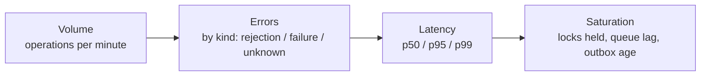

# Observability

You cannot reconcile what you cannot see. In a money system the three questions during
an incident are always the same: *did money move*, *where is the break*, and *what do
we tell the customer*. Observability exists to answer those in seconds, not to draw
pretty graphs.

---

## Philosophy

**Alert on symptoms, not causes.** "Transfer success rate below SLO" is an alert. "CPU
above 80%" is a dashboard line that someone looks at after the alert fired. A system that
pages on CPU is a system that pages on Tuesdays at 3am for reasons that cost no money.

**Every number has an owner.** A metric without a named consumer — a dashboard, an
alert, a runbook step — is deleted. Metrics are a budget.

**Traces answer "where", metrics answer "how much", logs answer "why".** Use each for
its job.

**Correlation is the spine.** One `correlation_id` threads a request through gateway,
transfer, wallet, core, rail, and the outbox. Without it, an incident is grep archaeology.

---

## The four golden signals, for money



For this platform a fifth signal dominates: **divergence** — the count of open integrity
breaks. It is not a performance signal; it is a correctness signal, and it is the one
that matters most.

---

## Metrics

Every service exports Prometheus metrics on `/metrics`, bound to the pod network only.
Names follow `echo_<subsystem>_<name>_<unit>`.

### The catalogue that must exist

| Metric | Type | Labels | Why |
|---|---|---|---|
| `echo_http_requests_total` | counter | `service`, `route`, `method`, `status` | The volume and error base |
| `echo_http_request_duration_seconds` | histogram | `service`, `route` | SLO measurement |
| `echo_ledger_entries_total` | counter | `account_type`, `operation_type` | Money written, by kind |
| `echo_ledger_amount_minor_total` | counter | `account_type`, `currency`, `direction` | Money written, by value |
| `echo_holds_open` | gauge | `account_type` | How many holds exist right now |
| `echo_holds_expired_total` | counter | — | A rising rate is a leak |
| `echo_balance_derivation_duration_seconds` | histogram | `kind` (full / checkpoint) | The Fineract lesson made visible |
| `echo_idempotency_replays_total` | counter | `route` | A spike means clients are retrying |
| `echo_idempotency_key_reused_total` | counter | `route` | A spike means a client bug |
| `echo_outbox_oldest_unpublished_seconds` | gauge | `service` | The relay's health |
| `echo_outbox_published_total` | counter | `service`, `event_type` | Publish rate |
| `echo_nats_consumer_lag` | gauge | `stream`, `consumer` | The consumer's health |
| `echo_transfer_sagas_by_state` | gauge | `state` | The saga population |
| `echo_transfer_saga_stuck_total` | counter | `state` | A saga in one state too long |
| `echo_posting_attempts_total` | counter | `core`, `outcome` | Core integration health |
| `echo_rail_attempts_total` | counter | `rail`, `outcome` | Rail integration health |
| `echo_webhook_delivery_failure_rate` | gauge | `subscription_tier` | Partner-facing health |
| `echo_recon_breaks_open` | gauge | `kind`, `severity` | The correctness signal |
| `echo_recon_run_duration_seconds` | histogram | `kind` | Reconciliation cost |
| `echo_ledger_integrity_breaks_open` | gauge | — | Zero, always, or the platform is in trouble |
| `echo_unknown_outcomes_open` | gauge | `source` | How many things we cannot say happened |

### What is deliberately not a metric

- **Balance.** Balance is a fact about an account, not a rate. Metrics with an account
  id as a label are a cardinality bomb and a privacy leak.
- **Per-customer anything.** High cardinality, and customer-identifying.
- **Raw SQL timing.** If the query matters, it appears in a trace span.

---

## Tracing

OpenTelemetry, OTLP to the collector. Every service creates spans; the gateway creates
the root span for a request and propagates `traceparent`.

### Span naming

```
HTTP server spans:   POST /v1/transfers/internal
HTTP client spans:   POST wallet.internal /v1/internal/lock-and-debit
DB spans:            pgx.query: SELECT accounts ... FOR UPDATE
Messaging spans:     publish payments.transfer
                     consume payments.transfer
Ledger spans:        ledger.post_transaction
Core spans:          core.post operation
Rail spans:          nip.transfer
```

### Attributes that must be on money spans

| Attribute | Value | Why |
|---|---|---|
| `account.id` | account id | Joins a trace to the ledger |
| `transaction.id` | transaction id | Joins a trace to an entry |
| `operation.type` | the closed enum value | Groups by business operation |
| `amount.minor` | the integer | Needed to follow money through a trace |
| `currency` | ISO 4217 | — |
| `correlation.id` | from the request | The spine |
| `outcome` | `applied` / `rejected` / `unknown` | The three-state answer |

`amount.minor` and `account.id` are trace attributes, not metric labels. A trace is
already scoped and access-controlled; a metric label is forever.

### What a trace must not contain

No tokens, no PANs, no passwords, no email addresses, no raw request bodies, no
PII in span names. An attribute that is a secret is a leak into every tracing backend it
ever passes through.

---

## Logs

Structured `slog` JSON to stdout. The collector ships them.

### Required fields

```json
{
  "ts": "2026-11-24T09:31:07.412Z",
  "level": "INFO",
  "service": "transfer",
  "version": "git-sha",
  "msg": "saga completed",
  "correlation_id": "10f3a2b8-...",
  "trace_id": "4bf92f...",
  "span_id": "00f067...",
  "transfer_id": "01J9B...",
  "duration_ms": 312,
  "outcome": "applied"
}
```

### Rules

- **Errors log at `ERROR` with the error's code, not the whole error string.** Internal
  detail is wrapped at the boundary.
- **No amounts or account numbers in log messages.** In fields, yes; in the interpolated
  string, no. A log line with `"paid 250000 to 0123456789"` is a PII leak.
- **No request bodies.** Bodies in logs are how tokens and PII end up in a log aggregator
  forever.
- **Some log is a domain event, most is not.** If the fact matters to another service, it
  belongs in the outbox, not in a log line that no one is listening to.

Level policy:

| Level | Use |
|---|---|
| `ERROR` | Something failed and a human should look |
| `WARN` | A degraded path was taken; the request succeeded anyway |
| `INFO` | One line per request, one line per state change |
| `DEBUG` | Only enabled in a debugging session, never in production by default |

---

## Dashboards

Four, and no more. Each answers a question someone actually asks.

### 1. Money health (the one on the wall)

- Operations per minute, split by outcome (`applied`, `rejected`, `unknown`)
- Success rate against SLO
- p99 latency against SLO
- `echo_unknown_outcomes_open` — the count currently unresolved
- `echo_ledger_integrity_breaks_open` — always zero
- `echo_holds_open` and its derivative

### 2. Sagas

- `echo_transfer_sagas_by_state` — a stacked area chart; the shape tells the story
- `echo_transfer_saga_stuck_total` by state
- Oldest saga in a non-terminal state (age)
- Compensation rate — a rising rate is a slow downstream

### 3. Integration health

- Posting to core: attempts, outcomes, p99, oldest unresolved `unknown`
- Rail: attempts, outcomes by code class, p99, unresolved unknowns
- Webhook: delivery rate, failure rate by subscription, dead-letter count
- Outbox age and consumer lag for each stream

### 4. Reconciliation and breaks

- Latest run per kind, its status and duration
- Open breaks by kind and severity, age of oldest
- Break creation and closure rate
- `echo_balance_derivation_duration_seconds` split by full and checkpoint

A dashboard that nothing alerts and nobody opens is deleted.

---

## Alerting

Alerts are defined in `deploy/alerts/` as Prometheus rules, reviewed in pull requests.
Every alert has `runbook:` and `severity:` annotations, and a runbook that does not exist
fails the build.

### Severities

| Severity | Meaning | Response |
|---|---|---|
| `critical` | Money is wrong, or money movement is stopped | Page now, all hands |
| `high` | SLO breached, or a subsystem is degraded | Page during hours, ticket after |
| `warning` | Trending toward the problem | Ticket, look next business day |
| `info` | Recorded for the dashboard | None |

### The alerts that matter

| Alert | Condition | Severity |
|---|---|---|
| `LedgerIntegrityBreak` | `echo_ledger_integrity_breaks_open > 0` | critical |
| `UnknownOutcomeAged` | an unknown older than 15 minutes unresolved | critical |
| `CoreRejected` | `echo_posting_attempts_total{outcome="rejected"}` rising | critical |
| `SagaStuck` | `echo_transfer_saga_stuck_total > 0` | high |
| `OutboxLagging` | `echo_outbox_oldest_unpublished_seconds > 30` | high |
| `ConsumerLagging` | `echo_nats_consumer_lag > 10,000` | high |
| `TransferSuccessSLOBurn` | 5-min error budget burn rate > 14.4 over 1 hour | high |
| `BalanceDerivationSlow` | p99 `echo_balance_derivation_duration_seconds` > 0.05 | warning |
| `WebhookDeadLetter` | any delivery reaches dead letter | warning |
| `HoldLeak` | `echo_holds_expired_total` rising faster than expected | warning |

### SLO burn-rate alerting

Multi-window burn rate rather than single-threshold error rate:

- 2% of the 30-day budget in 1 hour → page (`critical`)
- 5% of the budget in 6 hours → page (`high`)
- 10% of the budget in 3 days → ticket

This pages fast on real outages and stays quiet on a harmless blip.

---

## Runbooks

Every alert links to `deploy/runbooks/<name>.md`. A runbook contains:

1. **What this means** in one sentence, in money language, not infrastructure language.
2. **How to confirm** — the query or dashboard to open.
3. **What to do** — steps, with the command to run.
4. **What not to do** — the tempting-but-wrong action, and why it is wrong.
5. **How to know it is fixed.**
6. **When to escalate, and to whom.**

The most important line in any runbook on this platform: *do not compensate an unknown
outcome. Query it.* A runbook that suggests otherwise is a bug in the runbook.

### The first runbooks to write

- `ledger-integrity-break.md`
- `unknown-outcome.md`
- `saga-stuck.md`
- `outbox-lagging.md`
- `posting-rejected.md`
- `rail-unknown.md`
- `webhook-dead-letter.md`
- `postgres-failover.md`

---

## Retention

| Signal | Retention | Why |
|---|---|---|
| Metrics | 90 days at full resolution, 13 months downsampled | Year-over-year comparison |
| Traces | 7 days for all, 30 days for errors and money spans | Cost vs. usefulness |
| Logs | 30 days | Debugging window |
| Audit-relevant events | forever | Article XI; these are not logs |

Audit-relevant facts live in their owning service's tables, not in logs. An audit trail
that exists only in a log aggregator is not an audit trail.

---

## What the back office sees

TOVARYN consumes the operations event feed and the operator API. It does not scrape
Prometheus. The distinction:

- **Metrics** are for the people running the platform.
- **Events and breaks** are for the people running the institution.

A back-office operator should never need a Grafana login to know whether money
reconciled today.
