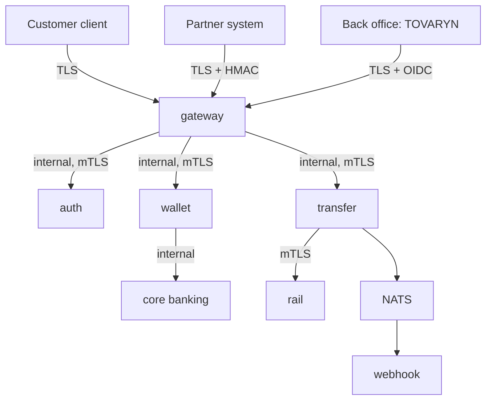

# Security

The threat model assumes the attacker has the same internet the customer does, and
that the highest-value target is the money path. Everything below follows from two
constraints: a stolen credential must be containable, and a compromised service must not
be able to authorise itself.

---

## Trust boundaries



The gateway is the only process reachable from outside. Everything else binds to the
private network and authenticates with mTLS. This is not defence in depth for its own
sake: it means a single misrouted rule cannot expose `wallet` directly.

| Boundary | Authenticated by | Not by |
|---|---|---|
| Customer → gateway | JWT access token | Session cookie alone |
| Partner → gateway | JWT + HMAC request signature | IP allowlist alone |
| Gateway → services | mTLS + signed internal identity header | The user's token passed through |
| Service → core | mTLS + core credentials from the secret store | Network position |
| Service → rail | mTLS + rail credentials | — |

---

## The token model

### Access token

- **Algorithm:** EdDSA (Ed25519). Not `HS256` — a symmetric algorithm means every
  verifier can also mint tokens.
- **Lifetime:** 15 minutes.
- **Claims:** `sub` (user id), `sid` (session id), `iat`, `exp`, `iss`, `aud`, `scope`.
- **Held:** in memory in the client, never in `localStorage`.
- **Verified by:** the gateway (signature, `exp`, `iss`, `aud`, not-revoked) and again by
  the receiving service (it does not trust the gateway's `200`).

### Refresh token

- **Format:** opaque, 256 bits random, stored hashed (SHA-256) in `auth`.
- **Lifetime:** 30 days, rotating on every use.
- **Held:** `HttpOnly; Secure; SameSite=Strict` cookie. A browser never sees it in
  JavaScript.
- **Reuse detection:** every refresh token belongs to a `family_id`. If a token is
  presented that was already rotated, the whole family is revoked and
  `identity.session.revoked` is emitted. This is the standard response to a stolen
  refresh token and it makes the theft detectable rather than silent.

### Revocation

Access tokens are short-lived, so revocation is a denylist keyed on `sid` in Redis with a
TTL equal to the token's remaining life. A logged-out session is denied within one
request, not within fifteen minutes.

| Requirement | Implementation |
|---|---|
| Logout is immediate | `sid` in Redis denylist, checked by gateway and services |
| Password change revokes sessions | All `sid`s for the user added to the denylist |
| Compromise response | `sid` or `sub` denylisted; refresh family revoked |
| Key rotation | New `kid` published to JWKS; old key verifies for the overlap window |

### Service-to-service identity

A service calling another does not forward the user's token. It sends a signed header:

```
X-Echo-Caller: {"service":"gateway","sub":"01J...","scope":["wallet:write"],"iat":...,"exp":...}
X-Echo-Caller-Signature: <Ed25519 over the canonical header JSON>
```

The callee verifies the signature against the gateway's public key. The user's `sub` is
carried as data; the *authority* to make the call is carried by the signature. This is
what lets `wallet` make its own authorisation decision instead of trusting the gateway to
have made it.

**The S2 static service token is deleted in S4.** A shared bearer token with no identity
is not authentication; it is a password every service knows.

---

## Authorisation

Authorisation lives next to the data, not at the edge.

- The gateway checks: is there a valid token, is the session live, is the route allowed
  for the scope.
- The wallet checks: does `caller.sub` equal `account.owner_ref`, or does the caller hold
  an operator scope that covers this account — and it checks against the same row lock
  and transaction that it is about to debit.

The reason is narrow and practical: a gateway that decides "user may read wallet X" must
fetch wallet X, which means the gateway now owns a copy of account ownership, which is
Article IX violated by the service that was supposed to enforce it.

### The scope table

| Scope | Grants | Held by |
|---|---|---|
| `wallet:read` | Read any wallet | Operator |
| `wallet:write` | Fund any wallet | Operator |
| `transfer:create` | Create transfers | Customer (own only) |
| `transfer:read` | Read any transfer | Operator |
| `command:execute` | Place and release review holds | Operator |
| `dispute:register` | Register a dispute | Operator |
| `statement:request` | Request a statement | Operator |
| `feed:read` | Read the event feed | Partner, operator |
| `recon:read` | Read breaks and runs | Operator |
| `recon:resolve` | Resolve a break | Operator (senior) |

Customer tokens carry `transfer:create` and `wallet:read` and nothing else. The wallet's
owner check does the rest.

### The authorisation matrix, by endpoint

| Endpoint | Customer (own) | Partner | Operator |
|---|---|---|---|
| `GET /wallets/{id}` | owner only | — | any |
| `POST /wallets/{id}/withdraw` | owner only | — | — (operators fund, not withdraw) |
| `POST /wallets/{id}/fund` | — | — | any, with reason |
| `POST /transfers/internal` | source owner | — | any |
| `POST /transfers/external` | source owner | — | any |
| `POST /commands/*` | — | — | scoped |
| `GET /feed/events` | — | own partner scope | any |

An operator cannot withdraw from a customer wallet. Funding and withdrawal are not
symmetric rights, and the asymmetric one is the one an insider would abuse.

---

## Secrets

| Secret | Stored in | Rotated |
|---|---|---|
| JWT signing keys | KMS or sealed secret, loaded at start | Every 90 days, with overlap |
| Database credentials | Secret manager, injected at runtime | Every 90 days |
| Core credentials | Secret manager | Per the institution's policy |
| Rail credentials | HSM or secret manager | Per the operator's policy |
| Webhook signing secrets | Encrypted at rest with a KMS data key | On partner request; old secret verifies for 24 h |
| mTLS private keys | Secret manager, mounted read-only | Every 90 days |

Rules:

- No secret in an environment file committed to the repository. CI fails on a
  high-entropy string in a tracked file.
- No secret in a log, an error message, a trace attribute or an event payload.
- Rotation is a rehearsed procedure with a runbook, not a hope. A rotation that has never
  been run is a rotation that does not work.
- The application reads secrets at startup and on a signal; a secret change does not
  require a redeploy where the platform allows reload.

---

## Transport and encryption

- TLS 1.3 on every external boundary; TLS 1.2 permitted only for a counterparty that
  cannot do better, recorded as an exception.
- mTLS on every internal boundary.
- Encryption at rest for the database, the object store and backups, with keys the
  institution controls.
- Passwords: argon2id, per-OWASP parameters, unique salt per credential, rehash on login
  when parameters change.
- No homegrown crypto. The standard library or a well-known, maintained package, pinned.

---

## Webhook security

Delivering money events to a partner URL is an SSRF and a confidentiality risk.

- **Signed** with HMAC-SHA256 over `timestamp.body`, constant-time comparison, five-minute
  replay window. See `reference/events.md`.
- **No redirects followed.** A redirect is how an allowlisted host becomes an internal
  one.
- **URL validated at subscription time and at delivery time:** no loopback, no link-local,
  no RFC 1918, no cloud metadata addresses, DNS resolved and checked before connect, and
  the resolved address pinned for the request.
- **Secrets are per-subscription**, generated by the platform, shown once, and re-issuable.
- **Payload is minimised** — the partner's own customer reference, the amount, the
  reference, and the event type. Not the customer's KYC, not internal ids, not the ledger.

---

## The threat model

Written as an ADR at S9, but the working version lives here from S4.

| Threat | Mitigation | Residual |
|---|---|---|
| Stolen access token | 15-min life, `sid` denylist, owner checks at the data | A 15-min window |
| Stolen refresh token | Rotation + reuse detection revokes the family | Theft is detected and contained |
| Credential stuffing | Rate limits, argon2id cost, lockout with backoff, breached-password check | — |
| Insider withdraws customer funds | Operators cannot withdraw; every command carries a reason and an actor; all writes attributable | Collusion with a second operator, which is audited |
| Forged internal caller | Signature required; the S2 shared token is deleted | A compromised gateway key |
| Replay of a money request | Idempotency keys + fingerprint mismatch rejection | — |
| Double debit under concurrency | Row locks in sorted order, SERIALIZABLE retry, `available ≤ ledger` | — |
| SQL injection | Parameterised queries only; `sqlc` generates them | — |
| Mass assignment | Explicit request structs; the actor is never read from the body | — |
| Enumeration | Cursor pagination, no public account list, uniform `404` for not-yours | Timing side channels, low value |
| SSRF via webhooks | Resolve-and-pin, block private ranges, no redirects | — |
| Event injection | Consumers validate `schema_ref`; unknown version is an error | — |
| Dependency compromise | Pinned versions, checksum database, `govulncheck`, SBOM | Zero-day, accepted |
| Log or trace leak | No PII or secrets in either; structured fields only | Developer error, reviewed |

---

## Supply chain

- **Pinned dependencies**, `go.sum` verified, module proxy checksum database enforced.
- **SBOM** generated per build and stored with the image.
- **Image scanning** in CI; a `critical` finding with a fix blocks merge; a fixless
  `critical` needs a written decision with an expiry.
- **`govulncheck`** in CI; a reachable vulnerability blocks merge.
- **Base images** rebuilt weekly, not inherited for a year.
- **Build provenance** signed; the deployed image's digest is recorded per release.
- **No dependency added without an ADR** or, for a small one, a line in the pull request
  explaining why the standard library does not do the job.

---

## Data protection

### PII

PII lives in `auth` and nowhere else in the money path. A wallet stores an `owner_ref`
that is opaque. A ledger entry stores accounts and amounts and an actor, never a name,
email, phone or address.

An event carries ids. A webhook carries the partner's own reference. A log carries
neither.

### Right to erasure

A customer asks to be forgotten:

1. `auth` redacts the user: email and phone are replaced with a tombstone, the credential
   is deleted, sessions are revoked.
2. The ledger is **not** touched. Entries, transactions and holds remain, referencing the
   now-tombstoned `owner_ref`.
3. The account is closed, not deleted.
4. An audit record of the erasure is kept: who asked, when, what was redacted.

This is the only defensible answer. Deleting ledger entries destroys the institution's
ability to answer a regulator or a dispute, and flipping a signed sum to zero is a
financial misstatement. The PII is the person; the entry is the institution's record.

### Retention

| Data | Retention | Basis |
|---|---|---|
| Ledger entries and transactions | Forever | Regulatory; Article IV |
| Audit and break history | Forever | Article XI |
| Users and credentials | Life of account + regulatory minimum | — |
| Sessions and refresh tokens | 90 days after expiry | — |
| Webhook delivery history | 90 days | — |
| Logs | 30 days | Operability |
| Traces | 7 days (30 for money and errors) | Operability |
| Backups | Per institution policy, tested by restore | — |

### Break-glass

An operator sometimes needs access outside their normal scope — during an incident, a
regulator request, or a failed reconciliation. Break-glass is:

- **A separate, time-boxed credential**, issued with a reason and an approver.
- **Every use audited** as a distinct event with actor, reason, and what was accessed.
- **Reviewed monthly**, and an unexplained use is an incident.

The alternative — a standing super-operator account — is the account that is compromised
in every case study.

---

## Security in the development process

- Threat model is revisited at every stage gate that changes a boundary.
- A change to authentication, authorisation, crypto, or the gateway's routing needs a
  second reviewer with a security role.
- A pen test before the pilot; critical and high findings closed before go-live.
- Security-relevant tests live in the integration tier: an authorisation test that says
  "customer A cannot withdraw from customer B's wallet and nothing changed" is a test,
  not a review comment.

---

## What this document is not

It is not a certification. It is the working model the team builds against. The
institution's own security function, the regulator's requirements, and the pen test will
each add to it, and the additions belong here, in the same pull request.
